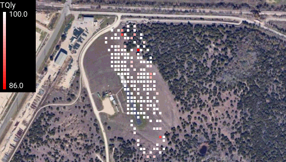
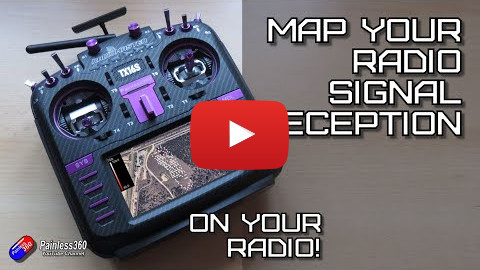
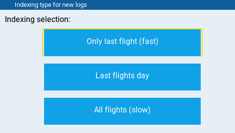
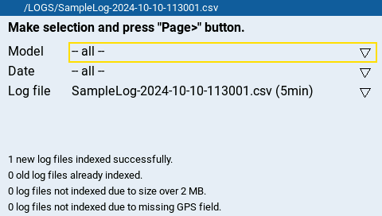
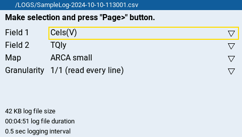
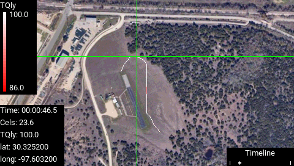
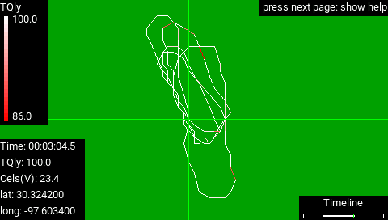

# GPS Viewer

GPS Viewer is an app for [color screen RC transmitters](https://manual.edgetx.org/color-radios) running EdgeTX that lets users plot logged flight telemetry on a map of their airfield. This is especially useful for identifying areas with poor radio transmission signal quality.

It can also be used to
- tune radio antenna alignment,
- assess GPS data accuracy before using it for autonomous flight,
- assess flight path consistency over multiple laps for racing and aerobatic competitions,
- verify that the aircraft remains within the desired airspace,
- and locate crashed aircraft.

Special thanks to Lee from the Painless360 YouTube channel for covering some of these use cases in more detail in the video below.

GPS Viewer is based on [Log Viewer](https://github.com/offer-shmuely/edgetx-x10-scripts/wiki/LogViewer) by Offer Shmuely, which is for plotting telemetry on a timeline.

## Installation

Copy the `SCRIPTS` directory to your transmitter.

Optionally also copy the `LOGS` directory to your transmitter if you'd like to have a sample log file with which to try out the app.

## Usage

To open the app, press the system button on your transmitter and select GPS Viewer.

1. Select log files to index. This step determines which fields have data that changes over time and takes about 30 seconds per MB. To keep log files small and indexing fast, it is recommended to use a logging interval of at least 1 second in EdgeTX.

    

2. Select a log file from the index.

    

3. Select fields to plot and a map to plot on. Fields with data that doesn't change over time are excluded.

    

4. View the plot. You can use the control sticks to select a subinterval of the timeline to plot and inspect individual data points.

    | Control | Action |
    | --- | --- |
    | Elevator stick | Zoom timeline |
    | Aileron stick | Pan timeline |
    | Rudder stick | Move crosshair |
    | Scroll wheel | Fine tune crosshair |
    | Scroll button | Toggle plot style |
    | Telemetry button | Toggle telemetry field |
    | Next page button | Toggle user interface |

    

To exit the app, press and hold the return button.

## Satellite Image

For flights at your local airfield, you can either use the included blank background (shown below) or add a satellite image of your airfield to the `SCRIPTS/TOOLS/gpsViewer` directory.

If you add your own image:

- Update [lib_config.lua](SCRIPTS/TOOLS/gpsViewer/lib_config.lua) with the minimum and maximum longitude and latitude coordinates of your image.
- For best results, match the image resolution to the screen resolution of your transmitter. For example, on the RadioMaster TX16S Mark II, the image should be 480x272 pixels.

To generate a satellite image, go to [Google Maps](https://www.google.com/maps) in your web browser, navigate to your airfield, and take a screenshot. Then use a free image editing program like [GIMP](https://www.gimp.org/) to crop and resize the screenshot to match the screen resolution of your transmitter.

To get the maximum longitude and latitude values for your image, return to Google Maps and right-click on the spot corresponding to the top right corner of your image. Similarly, to get the minimum longitude and latitude values, right-click on the spot corresponding to the bottom left corner of your image.
